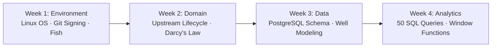

# OPERATION2031 — Engineering Portfolio

[](https://cachyos.org)
[](https://fishshell.com)
[-blue?style=flat-square&logo=git&logoColor=white)](https://git-scm.com)
[](https://www.postgresql.org)
[](https://www.python.org)
[](LICENSE)

Central engineering repository and portfolio hub for **OPERATION FREEDOM 2031 (OP2031)** — an intensive, long-range engineering initiative transitioning from petroleum data foundations to international Industrial AI & Energy Systems Architecture.

---

## 1. Month 01 — Foundation Sprint Overview

The primary objective of **Month 01 (Foundation Sprint)** is to establish an uncompromised, production-ready Linux engineering environment, build foundational competence in petroleum domain data modeling, and execute complex relational SQL analytics against real-world production datasets.

- **Target Capabilities**:
  - Stand up a reproducible, headless-capable data engineering environment on Linux.
  - Explain the upstream petroleum lifecycle and reservoir mechanics (Darcy's Law, decline curves) from first principles.
  - Design relational schemas for upstream operations (`wells`, `fields`, `production_daily`).
  - Execute a comprehensive benchmark suite of 50 analytical SQL queries (JOINs, aggregations, window functions).

---

## 2. Workstation Architecture & Specifications

All pipelines, schemas, and analytical suites in this repository are engineered and verified under strict real-hardware constraints:

| Component | Technical Specification | Operational Context |
| :--- | :--- | :--- |
| **Machine** | ASUS VivoBook S15 (X510UF) | Local Engineering Workstation |
| **Processor** | Intel Core i7 (8th Gen, 4C/8T) | Local batch processing & query optimization |
| **Memory** | 8 GB DDR4 | Strict memory hygiene; lightweight services |
| **Storage** | 1 TB HDD | Dedicated local data storage & logs |
| **Operating System** | CachyOS Linux x86_64 | High-performance, optimized Arch Linux base |
| **Kernel** | `7.2.4-3-cachyos` (PREEMPT_DYNAMIC) | Low-latency scheduler for development tasks |
| **Shell** | Fish Shell (`v4.9.3`) | Interactive terminal productivity |
| **VCS** | Git 2.56.0 with Ed25519 signing | Cryptographically verified commits |

---

## 3. Repository Directory Structure

```text
engineering-portfolio/
├── README.md               # Workstation setup & engineering portfolio manual
├── .gitignore              # Strict ignore rules for Python, DB, and OS artifacts
├── notes/                  # Domain notes, reservoir mechanics, and technical briefs
│   ├── .gitkeep
│   └── petroleum-domain.md # Upstream lifecycle & Darcy's law formulas (M01-W2)
└── sql/                    # Relational schemas, migrations, and analytical suites
    ├── .gitkeep
    ├── schema.sql          # DDL for fields, wells, and daily production records (M01-W3)
    ├── seed_data.sql       # Initial operational dataset
    └── queries/            # 50 benchmark SQL analytics queries (M01-W4)
```

---

## 4. Month 01 Execution Roadmap



- **Week 1 (Environment Setup)**: Configure primary CachyOS environment, Fish shell tooling, Git Ed25519 signed commits, and Python runtime isolation.
- **Week 2 (Petroleum Domain)**: Master upstream lifecycle phases (*Exploration → Drilling → Production → Abandonment*), reservoir rock-fluid properties, and Darcy's fluid dynamics equation.
- **Week 3 (Data Architecture)**: Deploy local PostgreSQL service, model normalized wellhead tables with relational integrity constraints, and ingest sample production records.
- **Week 4 (SQL Analytics & Delivery)**: Author and optimize 50 SQL queries covering multi-table JOINs, time-series aggregations, and window functions (`PARTITION BY`, cumulative production running totals).

---

## 5. Development Standards & Conventions

- **Commit Standards**: All commits adhere strictly to the [Conventional Commits](https://www.conventionalcommits.org/) specification:
  - `feat:` New analytical queries, schemas, or automation scripts.
  - `docs:` Domain notes, README updates, or architectural documentation.
  - `chore:` Configuration, dependencies, or repository maintenance.
- **Commit Verification**: Every commit is signed cryptographically using local Ed25519 SSH keys.
- **SQL Formatting**: Reserved SQL keywords are formatted in uppercase (`SELECT`, `JOIN`, `GROUP BY`, `OVER`) for visual clarity and strict schema consistency.
- **Python Hygiene**: All Python scripts run within isolated project virtual environments (`.venv`), prohibiting global package pollution.

---

## 6. Author

**Samuel Vivas**  
*Aspiring Industrial AI & Energy Systems Engineer*  
GitHub: [@Vivas2238](https://github.com/Vivas2238)

